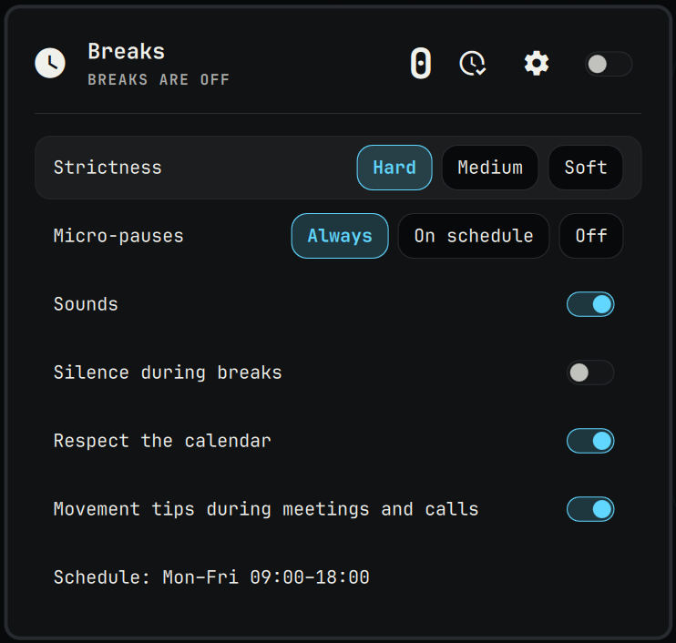

# Breaks

Breaks for the eyes and the body by active time; never during calls, video or meetings.

## Calls

A call is a capture stream that is not muted (the shell's microphone widget's
test). Two kinds of streams are open all the time and don't count: virtual ones
(filter chains such as omarchy-mic-denoise or echo cancel) and Oma's ear
(agent-speak, `node.name` `oma-ear`), which listens for her name on AC power —
the same rule as omarchy-presence. The camera is not a call signal: nothing
polls `/dev/video*` — a call without the microphone doesn't hold a break.

## Media

Media playing keeps away time from counting as a break (watching is work for
the eyes). Oma's own MPRIS player (agent-speak, `org.mpris.MediaPlayer2.oma`,
for the headset button) is not media: it «plays» only while she speaks.

## Colours

Status colours (red, orange) are fixed rather than the theme's, whose red or
yellow can be any colour: `FixedColors.qml` reads them from
`~/.config/omarchy/predmaxim/palette.json` (`{"red": "#e5534b", ...}`) and
falls back to the theme's alert colour without that file.
